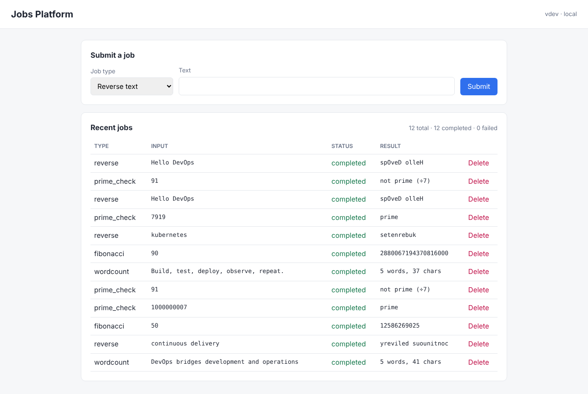
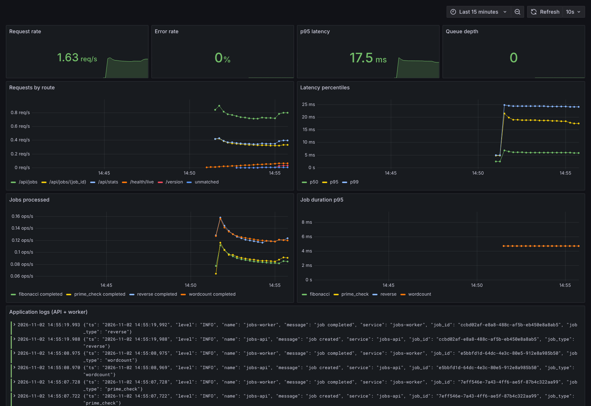
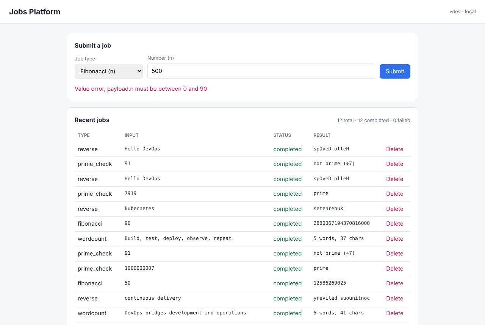
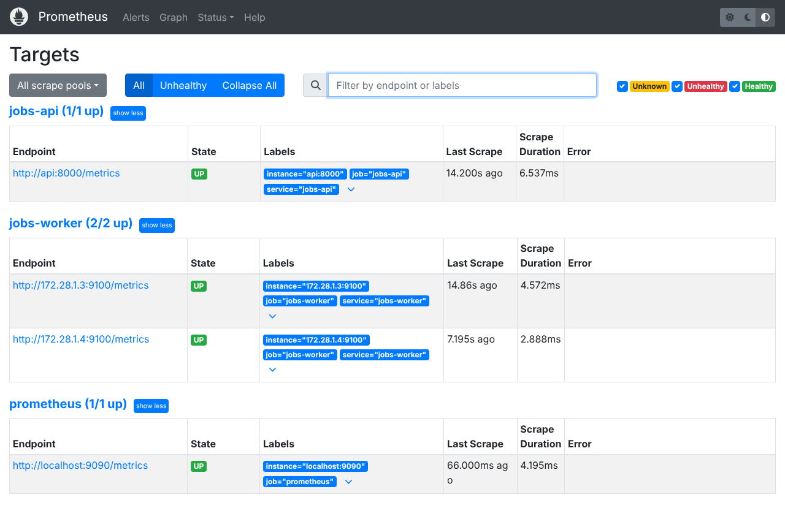

# Automated Testing & Deployment Platform

A CI/CD platform that takes a small microservices application through the full software
delivery lifecycle: multi-layer automated testing, security and policy gates, GitOps
delivery, progressive deployment (canary and blue-green) and observability. Everything
runs locally on Docker Desktop with Kubernetes enabled.

```
 git push ─▶ Jenkins ─▶ lint · unit · build · Trivy · OPA ─▶ ephemeral env: integration · Selenium Grid · k6 · ZAP
                                                              │
                                     push image ◀─────────────┘
                                         │
                       main ─▶ bump k8s/overlays/staging ──┐
                       v* tag ─▶ approval ─▶ bump production ┤──▶ Git ──▶ ArgoCD ──▶ Kubernetes
                                                                          ├─ staging: rolling update
                                                                          └─ production: Argo Rollouts
                                                                               ├─ api: canary + Prometheus analysis
                                                                               └─ frontend: blue-green
     Prometheus · Grafana · Loki   ◀── metrics & logs ──   Vault ─▶ secrets   Gatekeeper ─▶ admission policy
```

## Screenshots

| Jobs UI | Grafana: metrics + Loki logs |
|---|---|
|  |  |
| **Input validation** | **Prometheus targets** |
|  |  |

## The application

| Service | Stack | What it does |
|---------|-------|--------------|
| `services/api` | Python, FastAPI, SQLAlchemy | REST API for jobs: create, list, get, delete, stats. Prometheus `/metrics`, liveness and readiness probes |
| `services/worker` | Python, Redis | Background processor: reliable queue (`BLMOVE`), crash recovery, metrics on :9100 |
| `services/frontend` | nginx, vanilla JS | UI to submit and track jobs; reverse-proxies `/api` to the API |
| Postgres / Redis | | Storage and queue |

Job types are `wordcount`, `reverse`, `fibonacci` and `prime_check`.
Lifecycle: `queued → processing → completed | failed`.

## Quick start

```bash
make up                         # app at http://localhost:8080, API docs at http://localhost:8000/docs
make venv unit                  # unit tests (no Docker)
make integration e2e perf       # integration, Selenium Grid E2E, k6 smoke against the real stack
make up-full                    # + Grafana :3000 (admin/admin), Prometheus :9090, Loki, Vault :8200, Jenkins :8081
```

Kubernetes platform (Docker Desktop, Kubernetes enabled):

```bash
GITOPS_REPO_URL=https://github.com/<you>/devops-platform.git make bootstrap
```

That runs Terraform to install ingress-nginx, ArgoCD, Argo Rollouts, kube-prometheus-stack,
Loki and Promtail, Vault with the Vault Secrets Operator, and Gatekeeper. It then configures
Vault and registers the ArgoCD applications. See [docs/runbooks/bootstrap.md](docs/runbooks/bootstrap.md).

## Repository layout

```
services/              api, worker, frontend (each with a multi-stage Dockerfile: build → test → runtime)
tests/
  e2e/                 Selenium 4 + pytest, Page Object Model, runs on Selenium Grid (Chrome/Firefox)
  performance/         k6: smoke (CI gate), load (nightly), stress (capacity)
  security/            Trivy config + ignore list, OWASP ZAP rules
docker-compose.yml     local stack on 4 segmented networks (see network plan)
docker-compose.test.yml  Selenium Grid, test runners, k6
Jenkinsfile            the CI/CD pipeline
jenkins/               Jenkins image (plugins + tools) and Configuration-as-Code
k8s/
  base/                shared manifests: postgres, redis, worker, services, NetworkPolicies, PDBs,
                       ServiceMonitors, VaultStaticSecret, ingress
  components/
    deployments/       staging: Deployments + HPA (rolling update)
    rollouts/          production: Argo Rollouts (canary api, blue-green frontend) + AnalysisTemplates
  overlays/{staging,production}/   per-env namespace, hosts, replicas, image tags (bumped by CI)
argocd/                ArgoCD project + applications (rendered by Terraform)
terraform/             IaC: namespaces (quota, limits, PSA), Helm add-ons, Vault config, ArgoCD apps
security/
  opa/policies/        Rego policies + unit tests (conftest, shift-left)
  gatekeeper/          the same rules as admission control in the cluster
  vault/policies/      least-privilege Vault policies
monitoring/            Prometheus config + alert rules, Grafana dashboards, Loki and Promtail
scripts/               bootstrap, gitops-bump, smoke-test, rollback, vault-dev-init
docs/                  architecture, network addressing plan, testing strategy, deployment strategies, runbooks
```

## Documentation

- [Architecture](docs/architecture.md): application, pipeline, platform and security diagrams
- [Network addressing plan](docs/network-addressing.md): subnets, static IPs, ports, hostnames, NetworkPolicy matrix
- [Testing strategy](docs/testing-strategy.md): test pyramid, quality gates, practices
- [Deployment strategies](docs/deployment-strategies.md): rolling, canary, blue-green, and why each
- [Runbooks](docs/runbooks/README.md): alerts, rollback, release, bootstrap

## Quality gates (summary)

| Gate | Threshold |
|------|-----------|
| Unit tests | 100% pass, line coverage ≥ 80% |
| Image vulnerabilities | 0 fixable HIGH/CRITICAL (Trivy) |
| Secrets in repo | 0 |
| K8s manifests | 0 OPA `deny` (conftest), enforced again at admission (Gatekeeper) |
| Integration + E2E | 100% pass |
| Performance smoke | p95 < 300 ms, error rate < 1% |
| Canary analysis | success rate ≥ 95%, p95 < 500 ms on canary pods, else auto-rollback |
| Production | manual approval in Jenkins plus a blue-green promotion after the preview smoke test |
