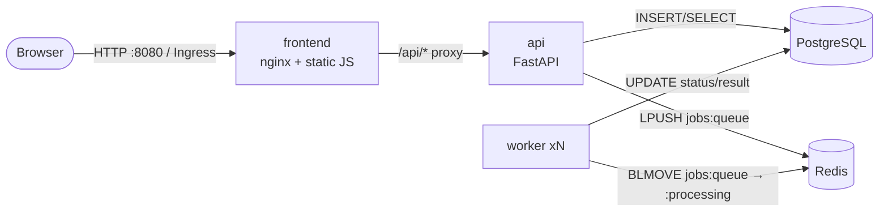
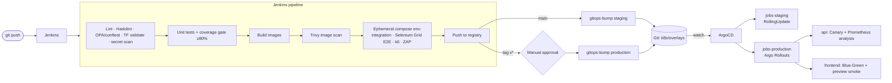
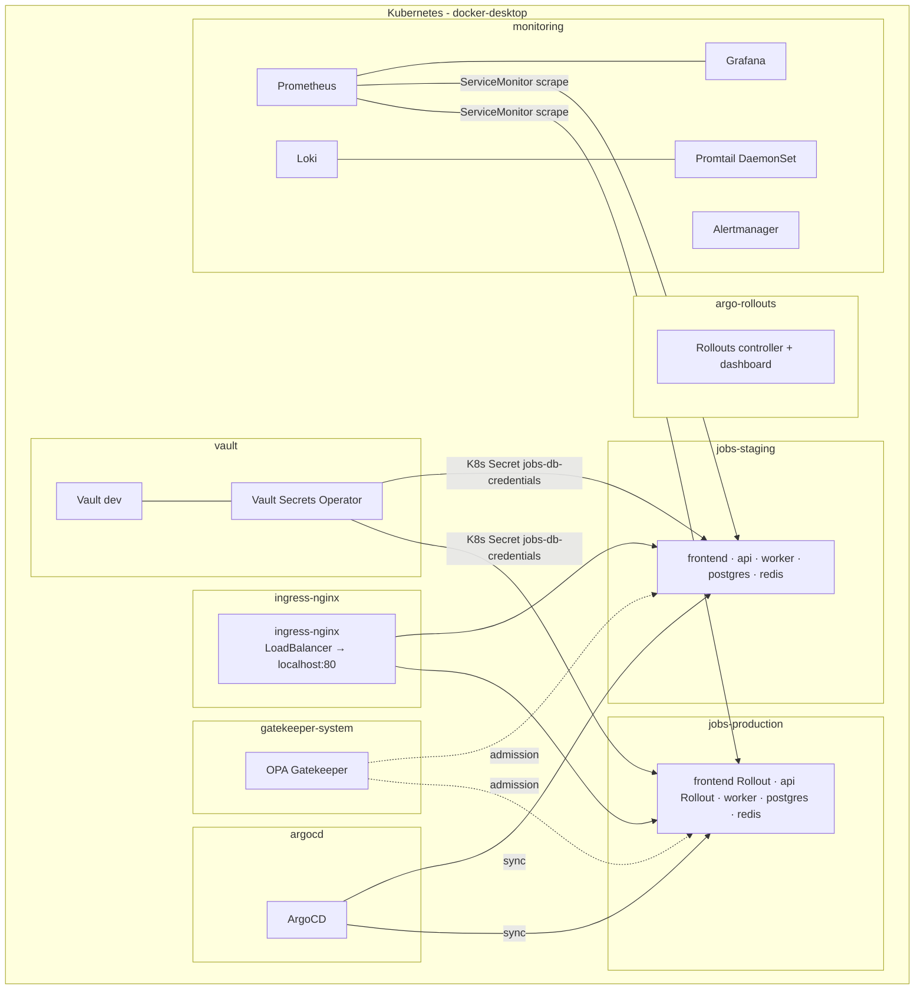

# Architecture

## 1. Application

| Service  | Tech                       | Responsibility | Port | Health |
|----------|----------------------------|----------------|------|--------|
| frontend | nginx-unprivileged, vanilla JS | UI; same-origin reverse proxy to the API | 8080 | `/healthz` |
| api      | Python 3.12, FastAPI, SQLAlchemy | Validate and store jobs, enqueue, query, stats, `/metrics` | 8000 | `/health/live`, `/health/ready` |
| worker   | Python 3.12, redis-py      | Process jobs (wordcount, reverse, fibonacci, prime_check) | 9100 (metrics) | `/metrics` |
| postgres | PostgreSQL 16              | System of record | 5432 | `pg_isready` |
| redis    | Redis 7 (AOF on)           | Job queue | 6379 | `PING` |

**Job lifecycle:** `queued → processing → completed | failed`.
The worker uses the *reliable queue* pattern (`BLMOVE` into a processing list). If a worker
crashes mid-job, the message stays in `jobs:queue:processing`, and the next worker to start
re-queues it (`Worker.recover()`).

**Design choices that matter for operations**
- 12-factor config: everything comes from env vars, and secrets come from Vault.
- JSON logs on stdout, with `service`, `level` and `job_id` fields, so Loki can parse them.
- RED metrics (rate, errors, duration) labelled by *templated* route, which keeps label cardinality bounded.
- Liveness and readiness are separate checks: readiness fails when the DB or Redis is down, so traffic is drained and the pod is not restarted.
- Containers are non-root with a read-only root filesystem, use multi-stage builds, and include a `test` stage that CI runs.

## 2. Delivery pipeline

Jenkins never runs `kubectl apply`. It only commits an image tag to Git, and ArgoCD makes
the cluster match Git. That gives every change an audit trail and makes `git revert` a rollback.

## 3. Platform (Docker Desktop Kubernetes)

Everything in this diagram is provisioned by **Terraform** (`terraform/`): Helm releases for the
add-ons, the namespaces (with ResourceQuota, LimitRange and Pod Security `restricted`), the Vault
KV secrets, policies and Kubernetes auth roles, and the ArgoCD project and applications.

## 4. Security layers

| Layer | Control | Where |
|-------|---------|-------|
| Code | Ruff lint, secret scanning (Trivy fs) | Jenkins *Static analysis* |
| Dependencies / images | Trivy HIGH/CRITICAL gate, `.trivyignore` with an owner and expiry per entry | Jenkins *Image scan* |
| Running app | OWASP ZAP baseline (DAST) | Jenkins *Ephemeral env* |
| Manifests (shift-left) | conftest + Rego in `security/opa/policies` | Jenkins, `make policy` |
| Admission (runtime) | Gatekeeper ConstraintTemplates (same rules) | `security/gatekeeper`, synced by ArgoCD |
| Secrets | Vault KV v2 → Vault Secrets Operator → K8s Secret; nothing in Git | `terraform/modules/vault-config` |
| Network | default-deny NetworkPolicies, explicit allow per flow | `k8s/base/networkpolicies.yaml` |
| Pods | non-root, read-only rootfs, drop ALL caps, seccomp RuntimeDefault, PSA `restricted` | all manifests |
